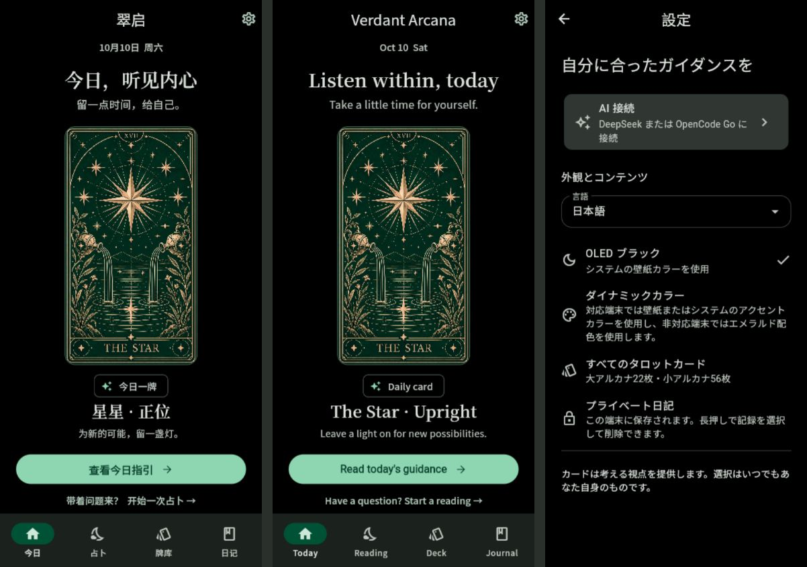
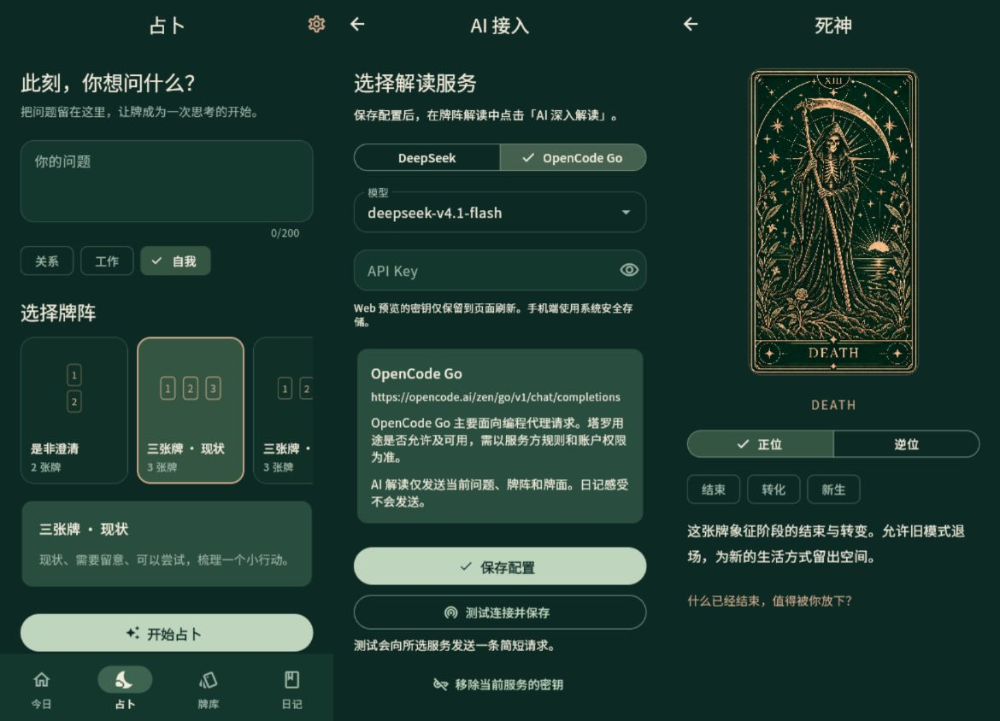
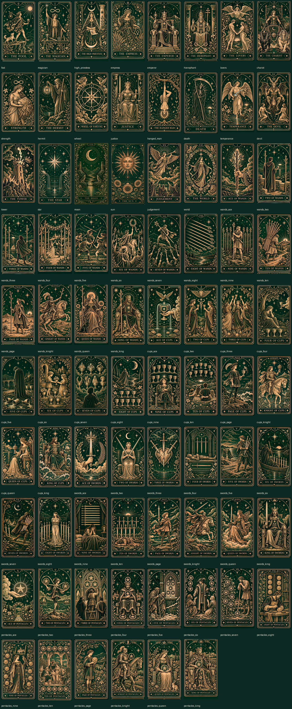

# 翠启 · Verdant Arcana


[中文](README.md) | English

A dark Flutter tarot app with OLED black backgrounds and system dynamic colors, centered on a large daily card. The Chinese name **翠启** combines emerald with insight; **Verdant Arcana** connects the palette to tarot's arcana. Version 0.3.

## What's new in 0.3

- Pure `#000000` page backgrounds, app bars and startup surfaces. The bottom navigation uses dynamic `surfaceContainer`; other UI elements also use native MD3 color roles.
- Material's `dynamic_color` provides Android 12+ wallpaper palettes and Windows system accent colors. Windows can derive its accent from wallpaper when that option is enabled in Windows settings. Unsupported platforms and the Web use an emerald fallback. Resuming the app refreshes the palette without resetting navigation or unfinished input.
- Settings → Language offers Simplified Chinese, English and Japanese, with immediate updates and persistent selection. UI, native Material controls, card names, keywords, interpretations and spreads are localized. English and Japanese card interpretations use separate concise copy. User questions, journal text and existing AI readings retain their original language; new AI responses use the selected language.
- A new three-card fan and geometric diamond icon.
- 18 tests pass, including mocked system palette updates, state retention, language persistence and preservation of journal text. Real-device dynamic colors remain unverified.



## Features

- Four destinations: Today, Reading, Deck and Journal. Settings opens as a separate page.
- All **78 cards**: 22 Major Arcana and 56 Minor Arcana, with distinct generated illustrations, keywords, upright and reversed meanings. Familiar symbols guide cards such as Death: a hooded skeleton and scythe.
- Nine graphical spreads: single card, two choices, yes/no clarification, three-card situation, past/present/future, relationship mirror, four elements, five-card cross and Celtic Cross.
- Random draws without duplicate cards, upright/reversed orientation, individual animated reveals and scrollable large spreads.
- Searchable, filterable deck and card detail pages.
- Local journal with long-press selection, multiple deletion, select all and an eight-second undo window.
- Optional AI reading with separate credentials for DeepSeek and OpenCode Go.
- Official Flutter **Material 3** components, `useMaterial3: true`, dark mode only. No third-party M3E component package.
- Ripple feedback, animated navigation and spread selection, page transitions, Hero transitions, 700 ms 3D card flips and orientation changes.

The interface supports Chinese, English and Japanese. The printed lettering inside card illustrations is part of the artwork and remains unchanged.

## AI configuration

Open Settings → AI access, select a provider and model, enter your own API key, then test and save. Connection testing sends a short request; full interpretations run only when you press the AI interpretation button.

| Provider | Models | Endpoint |
| --- | --- | --- |
| DeepSeek official | `deepseek-flash`, `deepseek-v4-pro` | `https://api.deepseek.com/chat/completions` |
| OpenCode Go | `deepseek-v4.1-flash` | `https://opencode.ai/zen/go/v1/chat/completions` |

The implementation follows the [DeepSeek documentation](https://api-docs.deepseek.com/) and [OpenCode Go documentation](https://docs.opencode.ai/docs/go/). Go requests carry a stable `x-opencode-session` and identify this application. Go primarily serves coding agents; availability for tarot use depends on the provider's rules and your account permissions.

Native builds use system-backed secure storage for API keys. Web preview keys remain in memory and disappear on refresh. Provider credentials are stored separately. AI requests contain the current question, spread positions, card names and orientations; they do not include journal reflections. Errors do not display raw provider responses or credentials.

Live authentication and billing have not been tested with real API keys. Mock HTTP tests cover request formats, response parsing, error handling and credential isolation. Browser requests may encounter provider CORS restrictions; no proxy is supplied to bypass them.

## Run locally

Validated with Flutter **3.41.9** and Dart **3.11.5**.

```sh
git clone https://github.com/CLCTY/verdant-arcana.git
cd verdant-arcana
flutter pub get
flutter run -d edge
```

For a static web build:

```sh
flutter build web --release --no-web-resources-cdn --no-wasm-dry-run
node tool/preview.cjs
```

Open http://127.0.0.1:4180. A 390 × 844 viewport shows the mobile layout; larger screens center the application.

```sh
flutter analyze
flutter test
flutter build apk --release
```

The Android project includes internet permission. An Android SDK is required to build the APK; no APK or physical-device verification is included in this release. Windows runner files are supplied, but Windows native compilation has not been validated.

Journal data stays on the current device or browser origin. Clearing app/site data removes it. Cloud sync and export are not implemented.

## Screenshots





## Project structure

| Path | Purpose |
| --- | --- |
| `lib/main.dart` | Theme, home, navigation and reading form |
| `lib/spreads.dart` | Spread positions and graphical selection |
| `lib/models.dart`, `lib/deck.dart` | Deck, random draws and journal persistence |
| `lib/pages.dart` | Card reveal, reading, library and details |
| `lib/journal.dart` | Journal selection, deletion and undo |
| `lib/settings.dart`, `lib/ai.dart`, `lib/ai_panel.dart` | Provider settings and AI readings |
| `assets/cards/` | 78 finished illustrations and one card back |
| `test/` | Deck/resource integrity, spreads, journal, AI and UI tests |

The internal Dart package remains `emerald_tarot` to preserve imports and existing local storage identifiers. User-facing branding is Verdant Arcana / 翠启. See [BRANDING.md](BRANDING.md) for the icon and palette.

## Assets and licensing

The card art and app icon were generated with ImageGen rather than copied from commercial decks. Bundled Chinese fonts come from Google Fonts; their SIL OFL license files are included under `assets/fonts/`. Only the finished card assets are shipped; generation drafts are excluded.

No open-source license has been selected for the project code or images. A public repository does not by itself grant redistribution rights. Font licensing is governed by the included OFL files.
